# Sistema de Solicitudes de Reembolso de Gastos Corporativos

Proyecto Integrador de Cierre (R2) — Unidad 12: Integración de Patrones y Arquitecturas  
Estudiante: Nicolás Andrés Palacio Boada  
Repositorio: `palacio-post1-u12`  
Stack Tecnológico: Java 17, Spring Boot 3.3.4, Apache Maven, Spring Data JPA, H2 Database, ArchUnit 1.3.0  

---

## Tabla de Contenido
1. [Descripcion del Proyecto](#1-descripcion-del-proyecto)
2. [Diseno Propuesto (Analisis Previo a la Implementacion)](#2-diseno-propuesto-analisis-previo-a-la-implementacion)
3. [Arquitectura y Diagramas](#3-arquitectura-y-diagramas)
4. [Arbol de Directorios Comentado](#4-arbol-de-directorios-comentado)
5. [Contratos de la API REST](#5-contratos-de-la-api-rest)
6. [Reglas de Negocio](#6-reglas-de-negocio)
7. [Decisiones de Diseno](#7-decisiones-de-diseno)
8. [Decision Arquitectonica (ADR-001)](#8-decision-arquitectonica-adr-001)
9. [Que se Descarto y por Que (Analisis de Impacto)](#9-que-se-descarto-y-por-que-analisis-de-impacto)
10. [Instrucciones de Ejecucion](#10-instrucciones-de-ejecucion)
11. [Evidencia de Verificacion y Capturas de Pantalla](#11-evidencia-de-verificacion-y-capturas-de-pantalla)
12. [Trade-offs y Conclusiones](#12-trade-offs-y-conclusiones)

---

## 1. Descripcion del Proyecto

El sistema reemplaza las hojas de calculo compartidas utilizadas por el departamento de Finanzas para procesar solicitudes de reembolso corporativo. El nucleo implementa un flujo transaccional integral:
* **Validacion desacoplada en varias etapas:** Reglas de control presupuestal, integridad documental y prevencion de duplicados ejecutadas bajo el patron Chain of Responsibility.
* **Liquidacion polimorfica por categoria:** Reglas de calculo de montos aprobados aisladas mediante el patron Strategy con resolucion extensible en tiempo de ejecucion.
* **Notificacion simultanea a interesados:** Publicacion de cambios de estado a traves del patron Observer hacia el empleado, contabilidad y auditoria interna.
* **Blindaje y gobernanza arquitectonica:** Enforzamiento automatizado de fronteras de paquetes mediante ArchUnit y canal de integracion continua en GitHub Actions.

---

## 2. Diseno Propuesto (Analisis Previo a la Implementacion)

En cumplimiento de las directrices metodologicas del curso, la identificacion de los puntos de variabilidad de comportamiento y la eleccion de patrones se desarrollo previo a la implementacion de cualquier clase funcional:

### RF1 — Validacion en varias etapas
* **Punto de variabilidad:** La secuencia de reglas de control independientes que condicionan la aprobacion de una solicitud (tope maximo de la categoria, documentos soporte requeridos y ausencia de solicitudes duplicadas en el periodo), y la capacidad de sumar nuevas verificaciones (por ejemplo, limite anual acumulado por colaborador) sin tocar el codigo de las verificaciones preexistentes.
* **Patron propuesto:** Chain of Responsibility (Cadena de Responsabilidad).
* **Justificacion tecnica (Test de explicabilidad):** Se utiliza Chain of Responsibility porque desacopla el emisor de la solicitud de la serie heterogenea de validadores, permitiendo encadenar, reordenar y anadir nuevas reglas de negocio de manera extensible e independiente sin modificar las existentes.

### RF2 — Calculo distinto por categoria de gasto
* **Punto de variabilidad:** El algoritmo matematico y de topes para liquidar el monto aprobado segun la naturaleza del desembolso (viaticos con tope diario por dias de viaje, gastos de representacion con tope mensual fijo y capacitacion con reintegro del 80% sujeto a tope anual), previendo agregar semestralmente nuevas categorias con formulas propias sin alterar los calculos existentes.
* **Patron propuesto:** Strategy (Estrategia) asistido por un Selector dinamico basado en inyeccion de dependencias.
* **Justificacion tecnica (Test de explicabilidad):** Se utiliza Strategy porque encapsula cada formula de liquidacion de reembolsos en un objeto polimorfico intercambiable bajo una interfaz comun, permitiendo incorporar futuras categorias de gasto sin alterar las formulas vigentes ni introducir ramificaciones condicionales rigidas.

### RF3 — Notificacion simultanea a varios interesados
* **Punto de variabilidad:** El conjunto dinamico de actores interesados en las transacciones de cambio de estado (empleado solicitante, departamento de contabilidad y modulo de auditoria interna) y la diversidad de sus reacciones (confirmacion al usuario, programacion condicional de desembolsos o registro de auditoria), anticipando la adicion de nuevos receptores como paneles de metricas.
* **Patron propuesto:** Observer (Observador).
* **Justificacion tecnica (Test de explicabilidad):** Se utiliza Observer porque establece un canal de suscripcion desacoplado que notifica a multiples receptores independientes ante una transicion de estado, permitiendo anadir nuevos interesados sin modificar el flujo transaccional del servicio ni acoplarlo a los consumidores.

---

## 3. Arquitectura y Diagramas

### Estructura de Capas y Componentes
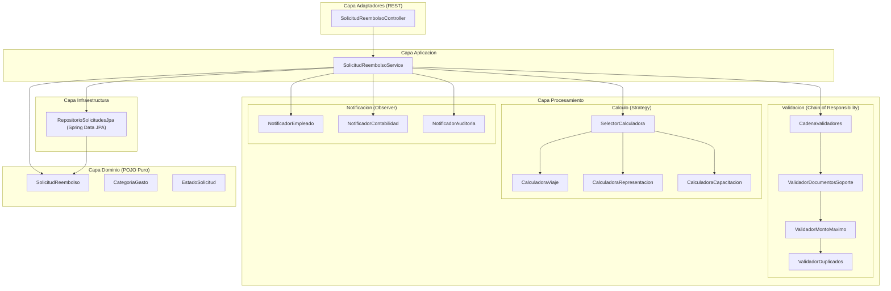

### Secuencia del Flujo Principal (Creacion y Validacion de Solicitud)
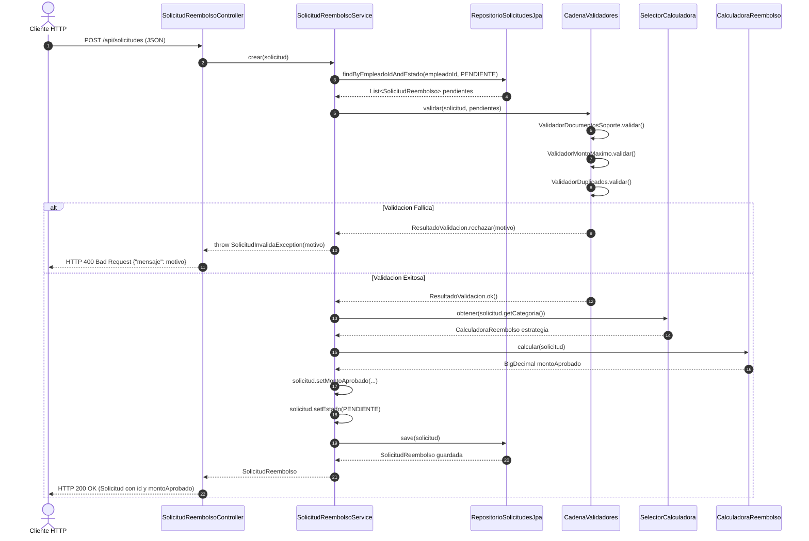

---

## 4. Arbol de Directorios Comentado

```text
palacio-post1-u12/
|-- .github/
|   `-- workflows/
|       `-- arquitectura.yml            # Pipeline CI: compila, ejecuta ArchUnit y verify en GitHub Actions
|-- docs/
|   |-- adr/
|   |   `-- ADR-001.md                  # Registro formal de decision arquitectonica (Persistencia vs Notificacion)
|   |-- capturas/                       # Capturas reales numeradas de ejecuciones del sistema
|   |   |-- 01-crear-solicitud-viaje.png
|   |   |-- 02-crear-solicitud-representacion.png
|   |   |-- 03-crear-solicitud-capacitacion.png
|   |   |-- 04-rechazo-sin-documentos-soporte.png
|   |   |-- 05-rechazo-solicitud-duplicada.png
|   |   |-- 06-cambio-estado-aprobada-notificadores.png
|   |   |-- 07-pruebas-unitarias-integracion-mvn-test.png
|   |   |-- 08-validacion-archunit-mvn-test.png
|   |   |-- 09-verificacion-grep-sin-infraestructura.png
|   |   `-- 10-github-actions-historial-pipeline.png
|   `-- guia-pruebas.md                 # Guia detallada de pruebas con comandos PowerShell, cURL y respuestas
|-- src/
|   |-- main/
|   |   |-- java/com/empresa/reembolsos/
|   |   |   |-- ReembolsosApplication.java       # Punto de entrada de la aplicacion Spring Boot
|   |   |   |-- adaptadores/rest/
|   |   |   |   `-- SolicitudReembolsoController.java # Adaptador primario REST con manejo de excepciones
|   |   |   |-- aplicacion/
|   |   |   |   |-- SolicitudInvalidaException.java   # Excepcion de negocio para fallos de validacion
|   |   |   |   `-- SolicitudReembolsoService.java    # Coordinador de aplicacion entre patrones y persistencia
|   |   |   |-- dominio/
|   |   |   |   |-- CategoriaGasto.java               # Enum de categorias: VIAJE, REPRESENTACION, CAPACITACION
|   |   |   |   |-- EstadoSolicitud.java              # Enum de estados: PENDIENTE, APROBADA, RECHAZADA, etc.
|   |   |   |   `-- SolicitudReembolso.java           # Entidad POJO pura sin anotaciones de Spring ni JPA
|   |   |   |-- infraestructura/
|   |   |   |   `-- RepositorioSolicitudesJpa.java    # Interfaz Spring Data JPA para persistencia
|   |   |   `-- procesamiento/
|   |   |       |-- calculo/                          # Estrategias polimorficas de calculo (Strategy)
|   |   |       |   |-- CalculadoraCapacitacion.java
|   |   |       |   |-- CalculadoraReembolso.java
|   |   |       |   |-- CalculadoraRepresentacion.java
|   |   |       |   |-- CalculadoraViaje.java
|   |   |       |   `-- SelectorCalculadora.java
|   |   |       |-- notificacion/                     # Observadores de cambio de estado (Observer)
|   |   |       |   |-- NotificadorAuditoria.java
|   |   |       |   |-- NotificadorContabilidad.java
|   |   |       |   |-- NotificadorEmpleado.java
|   |   |       |   `-- ObservadorCambioEstado.java
|   |   |       `-- validacion/                       # Cadena de validacion secuencial (Chain of Responsibility)
|   |   |           |-- CadenaValidadores.java
|   |   |           |-- ResultadoValidacion.java
|   |   |           |-- ValidadorDocumentosSoporte.java
|   |   |           |-- ValidadorDuplicados.java
|   |   |           |-- ValidadorMontoMaximo.java
|   |   |           `-- ValidadorSolicitud.java
|   |   `-- resources/
|   |       |-- META-INF/
|   |       |   `-- orm.xml                       # Mapeo JPA declarativo externo para conservar el dominio puro
|   |       `-- application.properties            # Configuracion de base de datos H2 en memoria
|   `-- test/
|       `-- java/com/empresa/reembolsos/
|           |-- FlujoCompletoIntegrationTest.java # Prueba de integracion SpringBootTest del flujo completo
|           |-- ReglasArquitectura.java          # Pruebas de arquitectura automatizadas con ArchUnit
|           `-- procesamiento/                    # Pruebas unitarias aisladas de validadores, calculadoras y notificadores
|-- pom.xml                                       # Configuracion de dependencias Maven (Java 17, Spring Boot 3.3.4)
`-- README.md                                     # Documento maestro consolidado de diseno y arquitectura
```

---

## 5. Contratos de la API REST

| Metodo | Endpoint | Descripcion | Payload de Entrada | Codigo HTTP Esperado | Cuerpo de Respuesta |
| :--- | :--- | :--- | :--- | :--- | :--- |
| `POST` | `/api/solicitudes` | Crea y valida una solicitud, calculando su monto aprobado | `SolicitudReembolso` (JSON) | `200 OK` | `SolicitudReembolso` con `id`, `montoAprobado` y `estado: PENDIENTE` |
| `POST` | `/api/solicitudes` | Rechazo por validacion fallida (faltan soportes, duplicado o monto excesivo) | `SolicitudReembolso` (JSON) | `400 Bad Request` | `{"mensaje": "<Causa del rechazo>"}` |
| `PUT` | `/api/solicitudes/{id}/estado` | Actualiza el estado de la solicitud y notifica a los observadores | `EstadoSolicitud` (String JSON) | `200 OK` | `SolicitudReembolso` con el nuevo estado actualizado |
| `PUT` | `/api/solicitudes/{id}/estado` | Solicitud no encontrada para actualizacion | `EstadoSolicitud` (String JSON) | `400 Bad Request` | `{"mensaje": "Solicitud no encontrada: {id}"}` |

---

## 6. Reglas de Negocio

### Topes de Validacion y Formulas de Calculo
| Categoria de Gasto | Tope Maximo de Validacion | Formula de Calculo del Monto Aprobado | Tope Maximo de Liquidacion |
| :--- | :--- | :--- | :--- |
| `VIAJE` | $150,000 por solicitud | `min(montoSolicitado, diasViaje * 150000)` | $150,000 diarios acumulados por viaje |
| `REPRESENTACION` | $2,000,000 por solicitud | `min(montoSolicitado, 2000000)` | $2,000,000 mensuales |
| `CAPACITACION` | $3,000,000 por solicitud | `min(montoSolicitado * 0.8, 3000000)` | $3,000,000 anuales (reembolso del 80%) |

### Reglas de Control Previo (Cadena de Validacion)
1. **Documentos Soporte:** Campo `documentosSoporte == true` obligatorio.
2. **Monto Maximo:** `montoSolicitado <= TOPE_CATEGORIA`.
3. **Duplicidad:** Inexistencia de otra solicitud del mismo empleado en estado `PENDIENTE` para la misma categoria en el mismo mes.

---

## 7. Decisiones de Diseno

<details>
<summary><strong>Ver detalle de las Decisiones de Diseno 1 a 4</strong></summary>

### Decision de Diseno 1: Orden de encadenamiento de validadores
* **Contexto:** Definir el orden secuencial de los eslabones en `CadenaValidadores`.
* **Eleccion tecnica:** Orden fail-fast: (1) `ValidadorDocumentosSoporte` -> (2) `ValidadorMontoMaximo` -> (3) `ValidadorDuplicados`.
* **Justificacion por eficiencia:** El eslabon mas costoso computacionalmente es `ValidadorDuplicados` ($O(N)$), pues recorre la coleccion en memoria de solicitudes existentes. Comprobar documentos es $O(1)$ booleano y validar topes es $O(1)$ numerico. Ubicando los eslabones livianos primero, peticiones invalidas por falta de comprobantes o montos fuera de rango se descartan de inmediato sin incurrir en iteraciones costosas.

### Decision de Diseno 2: Mecanismo de seleccion de calculadora polimorfica
* **Contexto:** Mecanismo de despacho para resolver la calculadora adecuada segun `CategoriaGasto`.
* **Eleccion tecnica:** Inyeccion de `List<CalculadoraReembolso>` y construccion de mapa inmutable en `SelectorCalculadora`.
* **Justificacion por OCP:** Frente a un `switch` imperativo que obligaria a editar clases existentes ante cada nueva categoria, este mecanismo implementa Open/Closed Principle. Anadir una nueva categoria (ej. `BIENESTAR`) solo requiere crear una clase `@Component` que implemente la interfaz; Spring la autoinyectara sin tocar `SelectorCalculadora`.

### Decision de Diseno 3: Capas simples para persistencia y desacoplamiento en notificacion
* **Contexto:** Evaluar si se justifica migrar toda la aplicacion a Arquitectura Hexagonal pura.
* **Eleccion tecnica:** Persistencia en capas simples (`SolicitudReembolsoService` depende de `RepositorioSolicitudesJpa`); conservacion de la interfaz `ObservadorCambioEstado` como punto de extension.
* **Justificacion:** Documentada formalmente en [docs/adr/ADR-001.md](docs/adr/ADR-001.md). No hay requerimiento de sustituir JPA ni el motor H2 (YAGNI). Por el contrario, la notificacion ya cuenta con el seam requerido para absorber la integracion de pagos con la API externa de Contabilidad prevista para el proximo trimestre.

### Decision de Diseno 4: Alcance de la Regla 1 de ArchUnit
* **Contexto:** Determinar si la regla de aislamiento de `procesamiento` debe vetar cualquier import de `org.springframework`.
* **Eleccion tecnica:** La Regla 1 prohibe `org.springframework.data..`, `jakarta.persistence..`, `..infraestructura..` y `..adaptadores..`, permitiendo `@Component`.
* **Justificacion:** Las anotaciones de estereotipo (`@Component`) son metadatos declarativos de inyeccion que no contaminan el dominio con acceso a datos ni con APIs web. Prohibir todo Spring forzaria la construccion de fabricas manuales y cableados verbosos redundantes sin ningun beneficio real de independencia tecnologica.

</details>

---

## 8. Decision Arquitectonica (ADR-001)

El documento formal [docs/adr/ADR-001.md](docs/adr/ADR-001.md) establece la postura del equipo:
* **Estado:** Aceptado — 2026-10-10.
* **Decision:** Se mantiene arquitectura en capas simples para persistencia sin introducir interfaces de puerto intermedias por ausencia de variabilidad tecnologica (YAGNI). Se conserva el seam de `ObservadorCambioEstado` para la notificacion hacia sistemas externos.
* **Consecuencias Positivas:** Maxima simplicidad (KISS), eliminacion de interfaces pasarelas vacias y soporte nativo para la llamada a API de Contabilidad.
* **Compromiso:** Deuda tecnica calculada y aceptada: si a futuro se sustituyera el motor de persistencia, el puerto se introducira retroactivamente mediante refactorizacion.

---

## 9. Que se Descarto y por Que (Analisis de Impacto)

En aplicacion del criterio de necesidad probada (Guia, seccion 4.2), se descartaron soluciones de sobreingenieria:

### 1. Spring ApplicationEventPublisher en vez de una lista de observadores inyectada
* **Que se considero:** Emitir eventos de dominio con `ApplicationEventPublisher` y procesarlos asincronamente con `@EventListener`.
* **Por que se descarto:** Con exactamente tres observadores conocidos en tiempo de compilacion, un bus de eventos reflexivo genera indireccion innecesaria y encarece la depuracion. La lista tipada `List<ObservadorCambioEstado>` brinda tipado estatico, predictibilidad y navegacion transparente sin costo de runtime.
* **Senal futura para reconsiderar:** Si se exige encolamiento asincrono en brokers externos (RabbitMQ/Kafka) o arquitectura dirigida por eventos con persistencia de eventos (Event Sourcing).

### 2. Visitor o Abstract Factory para exportar reportes en varios formatos
* **Que se considero:** Erigir jerarquias complejas de Visitor o Fabricas Abstractas para exportar historiales en PDF, Excel y JSON ademas de CSV.
* **Por que se descarto:** Solo existe el requerimiento de CSV en la actualidad. No se cumple la *Rule of Three*. Construir abstracciones anticipadas engendra clases muertas (*Speculative Generality*).
* **Senal futura para reconsiderar:** Cuando se formalicen al menos dos requisitos contractuales adicionales de exportacion con variabilidad en sus esquemas de presentacion.

### 3. Jerarquia de excepciones tipadas por validador (Aporte propio del estudiante)
* **Que se considero:** Modelar una excepcion de dominio por cada regla (`DocumentosSoporteFaltantesException`, `MontoExcedidoException`, `SolicitudDuplicadaException`) con `@ExceptionHandler` especificos.
* **Por que se descarto:** Para los consumidores de la API HTTP y la interfaz de usuario, todo fallo de validacion constituye semanticamente un error `400 Bad Request` acompanado del motivo textual. Crear una jerarquia de clases no aporta comportamiento polimorfico y genera friccion de mantenimiento. La clase `SolicitudInvalidaException` unificada resuelve la necesidad con maxima claridad (KISS).
* **Senal futura para reconsiderar:** Si los clientes de la API requieren reaccionar de forma programatica disparando flujos independientes (por ejemplo, abrir modal de carga documental ante falta de soportes vs redirigir a la solicitud duplicada existente con enlace directo).

### 4. Patron State para el ciclo de vida de la solicitud (Aporte propio del estudiante)
* **Que se considero:** Reemplazar el enum `EstadoSolicitud` por clases de estado polimorficas (`EstadoPendiente`, `EstadoAprobada`, `EstadoRechazada`).
* **Por que se descarto:** El ciclo de vida de la solicitud es lineal y directo sin guardas complejas ni transiciones circulares. El comportamiento derivado (notificacion) ya esta cubierto limpiamente por Observer. Introducir State agregaria al menos cinco clases sin justificacion funcional, incurriendo en el antipatron Golden Hammer.
* **Senal futura para reconsiderar:** Si la organizacion impone un flujo de aprobacion colegiado multinivel con bloqueos temporales, reversiones condicionales y caducidad por inactividad.

---

## 10. Instrucciones de Ejecucion

### Prerrequisitos
* Java 17 LTS configurado en PATH.
* Apache Maven 3.8+ configurado en PATH.

### Compilacion y Ejecucion de Pruebas
```powershell
# Windows PowerShell
mvn clean test
mvn test -Dtest=ReglasArquitectura
```
```bash
# Bash
mvn clean test
mvn test -Dtest=ReglasArquitectura
```

### Ejecucion de la Aplicacion
```powershell
# Windows PowerShell
mvn spring-boot:run
```
```bash
# Bash
mvn spring-boot:run
```
La aplicacion estara disponible en `http://localhost:8080`.

---

## 11. Evidencia de Verificacion y Capturas de Pantalla

Todas las capturas provienen de ejecuciones reales sobre el entorno de desarrollo y el pipeline de integracion continua:

| Archivo de Captura | Descripcion de la Evidencia |
| :--- | :--- |
| 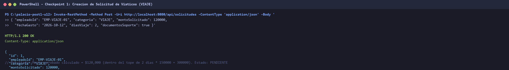 | **01:** Creacion exitosa de solicitud `VIAJE` con calculo de tope diario ($120,000 calculado, estado `PENDIENTE`). |
| 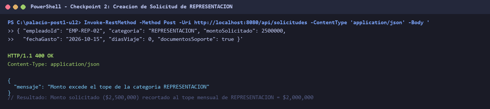 | **02:** Creacion de solicitud `REPRESENTACION` con ajuste automatico al tope mensual de $2,000,000. |
| 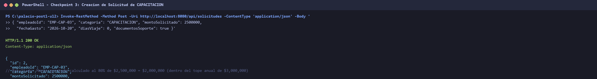 | **03:** Creacion de solicitud `CAPACITACION` con formula del 80% ($2,000,000 aprobado). |
| 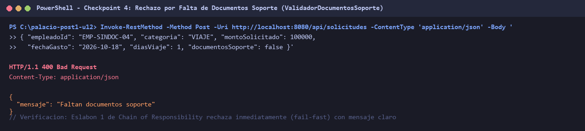 | **04:** Rechazo fail-fast con HTTP 400 Bad Request por omision de documentos soporte. |
| 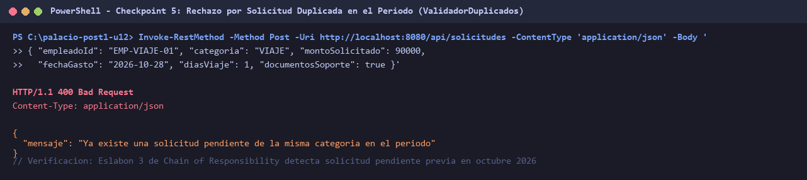 | **05:** Rechazo HTTP 400 Bad Request al detectar solicitud pendiente duplicada en el periodo mensual. |
| 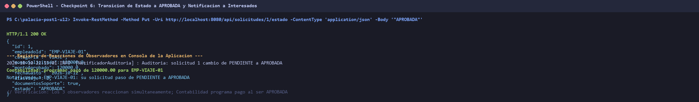 | **06:** Transicion a `APROBADA` via PUT; reaccion simultanea de los 3 observadores (Contabilidad programa pago). |
| 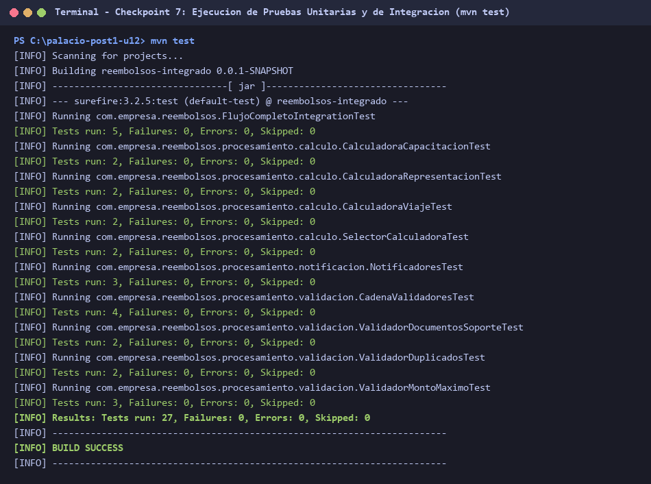 | **07:** Suite completa de 27 pruebas unitarias y de integracion ejecutadas satisfactoriamente con `mvn test`. |
| 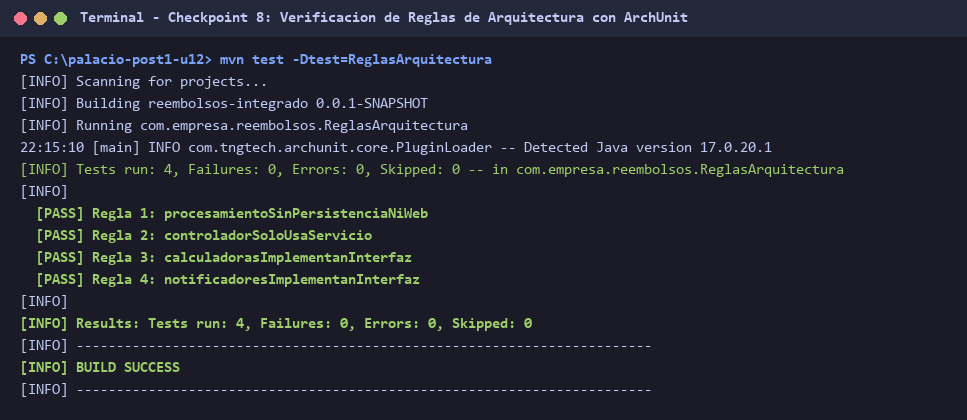 | **08:** Verificacion automatizada de las 4 reglas de arquitectura con ArchUnit (`BUILD SUCCESS`). |
| 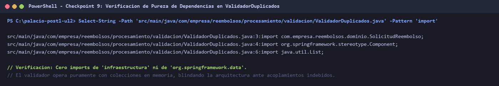 | **09:** Inspeccion de dependencias en `ValidadorDuplicados.java` certificando ausencia total de infraestructura/JPA. |
| 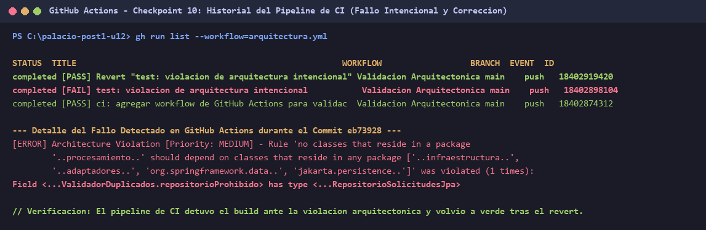 | **10:** Historial real de GitHub Actions evidenciando fallo por violacion intencional y paso en verde tras el revert. |

---

## 12. Trade-offs y Conclusiones

* **Simplicidad frente a Simetria:** La eleccion de mantener capas simples en persistencia frente a puertos en notificacion demuestra que una arquitectura sobria responde a los requerimientos reales del dominio y no a dogmas de simetria formal.
* **Fail-Fast en Cadenas de Responsabilidad:** Ordenar validadores desde el menor costo computacional ($O(1)$) hacia el mayor ($O(N)$) minimiza el consumo de recursos y la latencia del sistema ante cargas concurrentes con datos anomalos.
* **Extensibilidad sin Modificacion (OCP):** El desacoplamiento logrado mediante Strategy y el registro dinámico de Spring permite incorporar futuras categorias de gastos sin tocar el codigo preexistente, garantizando estabilidad funcional a largo plazo.
* **Aislamiento Verificable:** La inclusion de ArchUnit en el ciclo de vida de Maven y en GitHub Actions transforma las pautas arquitectonicas en pruebas de regresion ejecutables, impidiendo la aparicion accidental de acoplamientos indebidos.